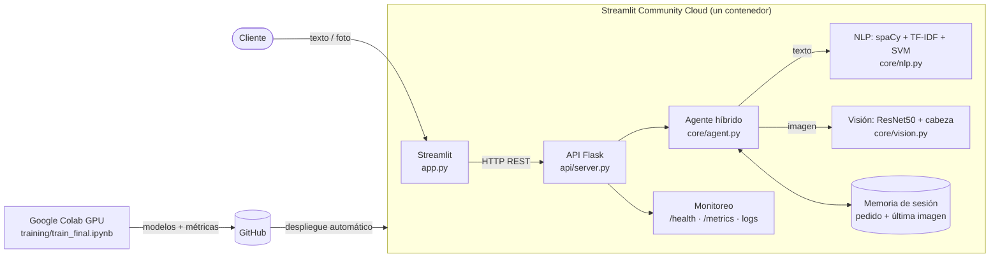
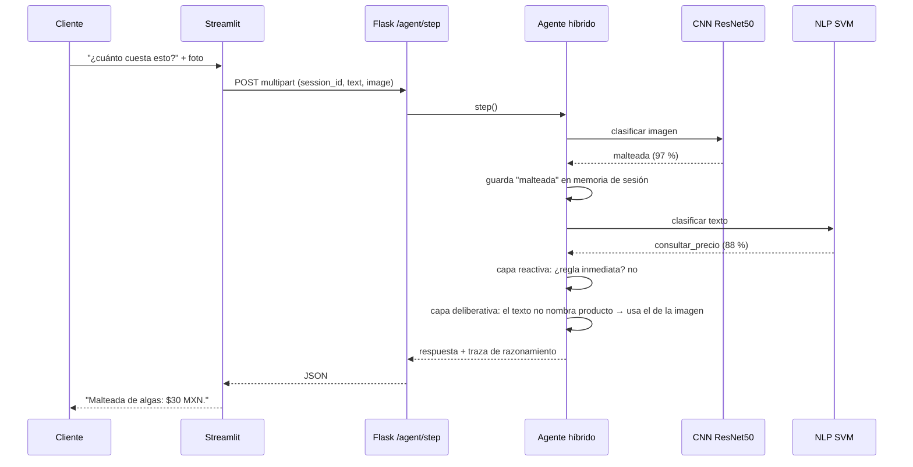

# 🍔 El Crustáceo Cascarudo – Asistente inteligente de pedidos

Proyecto final de **MBIA2602** (Maestría en Inteligencia Artificial, Universidad Tecmilenio).
Aplicación web que toma pedidos de un restaurante combinando:

- **Chatbot NLP**: preprocesamiento con spaCy (stopwords personalizadas que conservan negaciones) + **TF-IDF + SVM** para clasificar 8 intenciones.
- **Clasificador visual**: **ResNet50** con transferencia de aprendizaje (cangreburger, papas, malteada).
- **Agente inteligente híbrido** que coordina ambos componentes y mantiene la memoria del pedido.
- **API REST en Flask** con los servicios de inferencia + **interfaz web en Streamlit**.

**App en línea:** https://chatbot-pedidos-crustaceo-2xpimpzi8wttstcikty5fn.streamlit.app/ · **Video de demostración:** `<pendiente>`
**Autor:** Mauro Cesar Faz Turrubiate · Matrícula al07319285

## Resultados

| Componente | Conjunto de evaluación | Accuracy | F1 macro |
|---|---|---|---|
| Intenciones (spaCy + TF-IDF + SVM, 8 clases, 222 frases) | Prueba 20 % (45 frases) | 0.933 | 0.933 |
| Visión (ResNet50, 3 clases, 225 imágenes) | **Prueba independiente 15 % (34 imágenes)** | 0.853 | 0.852 |
| Chatbot completo (15 conversaciones, 23 turnos) | Éxito de tarea 0.933 · intención 1.00 · acción del agente 0.957 · fallback 4.3 % | | |

Detalle en `models/metrics_*.json`, `docs/metricas/` y `docs/pruebas/`.

## Arquitectura



### Flujo de coordinación del agente



## Estructura

```
app.py                  Interfaz Streamlit (arranca la API Flask en segundo plano)
api/server.py           API REST Flask: /health /metrics /nlp/intent /vision/classify /agent/step
api/runner.py           Lanza Flask en un hilo dentro del mismo contenedor
core/text.py            Normalización, tokenización, stopwords personalizadas, lematización
core/nlp.py             Clasificador de intenciones + extracción de productos y cantidades
core/vision.py          ResNet50 + cabeza entrenada, validación de imágenes
core/agent.py           Agente híbrido (reactivo + deliberativo) con memoria de sesión
data/                   Corpus de intenciones, menú y conversaciones de prueba
models/                 Modelos entrenados y métricas (generados en Colab)
scripts/                Entrenamiento, evaluación del chatbot y benchmark
training/               Cuaderno de Colab que lo ejecuta todo
tests/                  Pruebas automáticas (pytest)
avances/                Entregas anteriores (Avance 1 y 2)
```

## Ejecutar localmente

```bash
pip install -r requirements.txt
streamlit run app.py          # levanta también la API Flask en http://127.0.0.1:5000
python -m pytest -q           # pruebas automáticas (requieren spaCy y es_core_news_sm)
```

## Actualizar la app desplegada

Streamlit Cloud baja el código nuevo en cada push, pero la API Flask sigue corriendo en su hilo. Si cambian la API, los modelos o los umbrales (`core/config.py`), hay que hacer **Manage app → ⋮ → Reboot app**.

## Reentrenar

Abrir `training/train_final.ipynb` en Google Colab con GPU y ejecutar todo. Guarda modelos y métricas en `Mi unidad/crustaceo_entrega/`.
